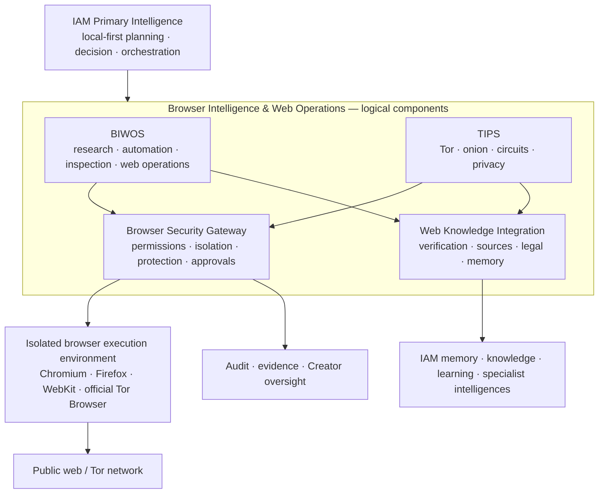

# IAM — Browser Intelligence & Web Operations Master Specification

**Document:** 29 — **Master Specification** (addendum to Documents 01–28)  
**Version:** 1.0 · 27 November 2026  
**Status:** **CONFIRMED — OD-49 confirmed 27 November 2026; part of the frozen baseline.** This document does not alter any locked decision (OD-01…OD-46, OD-49), the existing system count or the system register, and does not affect OD-47 (owner-confirmed 27 Nov 2026, not a signed Creator decision) or OD-48 (confirmed 27 Nov 2026). It is a **complete architecture and implementation specification**, **not** confirmation that any capability described here has been implemented or security-tested.  
**Parent:** `IAM_FINAL_CONSOLIDATION.md`, `canonical/IAM_DOC_01_MASTER_ARCHITECTURE.md` (the early master draft is superseded)  
**Related:** Doc 11 `IAM_UNIVERSAL_WEBSITE_INTERACTION_SPEC.md` (OD-27), Doc 14 `IAM_GLOBAL_RESEARCH_AND_KNOWLEDGE_SPEC.md` (OD-30), Doc 15 `IAM_LEGAL_INTELLIGENCE_AND_COMPLIANCE_SPEC.md` (OD-31), Doc 23/23-A (OD-38/OD-46), `IAM_RESOURCE_AND_WORKLOAD_MANAGER_SPEC.md` (OD-39), `IAM_MODEL_EVOLUTION_AND_FINE_TUNING_SPEC.md` (OD-40), Doc 26 `IAM_HUMAN_BEHAVIOUR_INTELLIGENCE_SPEC.md` (OD-45), Doc 27 (OD-47 owner-confirmed 27 Nov 2026, not a signed Creator decision), Doc 28 `IAM_IP_AND_LEGAL_INTELLIGENCE_MASTER_SPEC.md` (OD-48, confirmed 27 November 2026), `IAM_SECURITY_AND_INTERNET_POLICY.md`, `IAM_PRIVACY_AND_SECRETS.md`, `IAM_API_CONTRACTS.md`, `IAM_DATABASE_DESIGN.md`, `IAM_OWNER_DECISIONS.md`  
**Confirmed decision:** OD-49 (BIWOS/TIPS as a permanent core browsing capability of IAM's local intelligence)  
**Architecture status:** **FROZEN AT DESIGN LEVEL** — 20 of 20 coverage requirements met (see §13). Further capabilities are implementation requirements or future extensions, not new core modules.  
**Governing distinctions:**

> 1. **IAM controls the browser; websites do not control IAM.**
> 2. **IAM can independently research and operate, but cannot independently authorise sensitive external actions.**
> 3. **IAM's browser is a core capability of its local intelligence, not a dependency on an external AI provider.**

---

## 0. Executive summary and design thesis

IAM must be able to operate a browser much like a human does — not merely fetch pages. This specification defines a complete browsing operating environment inside IAM. It comprises **four logical components** working together under IAM's primary intelligence:

| Component | Full name | Responsibility |
|-----------|-----------|----------------|
| **BIWOS** | Browser Intelligence & Web Operations System | Internet browsing, research, automation, website interaction, document handling and browser intelligence |
| **TIPS** | Tor Intelligence & Privacy System | Tor Browser, onion services, circuits, privacy sessions, bridges and Tor network monitoring |
| **Browser Security Gateway** | Unified browser security and permission enforcement | Security, permissions, session isolation, malicious-site protection, download scanning and Creator approvals |
| **Web Knowledge Integration** | Controlled research-to-knowledge bridge | Connects browser research to memory, knowledge, learning and other intelligence systems, with source verification and legal checks |

> **These are four proposed architectural components, not four separately implemented systems.** They are functional responsibilities inside existing IAM systems (principally systems 2, 3, 5, 6, 12, 13 and 14). No new top-level system, no new AI identity and no new authority over the Creator is created. No implementation, deployment, engine installation or security validation is claimed by this document.

This document is complete before coding. It defines: complete browser and Tor capability inventories; component inventories; a standard internal browser API; a task queue; permission and operating modes; security, legal and privacy gates; data contracts and schemas; cross-system integrations; adversarial testing; lifecycle management; and eight implementation phases with exit criteria.

**Non-negotiable operational constraints:**

- Browser access must remain available when external LLM providers are unavailable. Local-first browsing must not require a hosted model.
- Tor and ordinary browsing must have independent network and identity boundaries.
- Browser research must never automatically become trusted knowledge.
- Autonomous browsing must never imply autonomous authority to spend money, disclose private information or enter legal agreements.
- Every capability must have documented tests, security controls and recovery procedures.

---

## 1. Scope, status and governing principles

### 1.1 What this adds — and what it does not

- **Adds:** a frozen browser architecture (BIWOS + TIPS), two enforcement gateways (Browser Security Gateway, Web Knowledge Integration), a standard internal browser API, task queue, permission model, evidence preservation, Tor privacy system, and an implementation phase plan.
- **Extends and completes:** OD-27 (UWAIE — universal website interaction), OD-30 (global research), OD-31 (legal intelligence), OD-47 (research acquisition, owner-confirmed 27 November 2026, not a signed Creator decision) and OD-48 (IP/legal governance, confirmed 27 November 2026) with an operational browser substrate. This document supplies the *browser operating environment* those decisions assume; it does not reinterpret them.
- **Does not:** change identity (OD-01), signing (OD-03), financial authority (OD-04/OD-25), protected core (OD-11), Creator channels (OD-18/19/42), foundation-model set (OD-38/OD-46), resource control (OD-39), model development (OD-40), frozen research scope (OD-41) or HBI boundaries (OD-45).
- **Does not:** grant IAM authority to create accounts, accept contracts, agree to subscriptions, make purchases or represent the Creator without authorisation.
- **Does not:** claim that every capability is implemented, security-tested or operational. Implementation status is recorded only in phase exit criteria (§12).

### 1.2 Relationship to existing architecture

| Decision / document | Relationship |
|---------------------|--------------|
| OD-27, Doc 11 UWAIE | Inherited unchanged. This spec defines the browser environment in which UWAIE workflows run. Frontend-first, APIs optional, mandatory permission check and outcome verification remain in force. |
| OD-30, Doc 14 global research | Browser research is one acquisition route; provenance, date, traceability and correction rules are inherited. |
| OD-31, Doc 15 / OD-48 | Legal and copyright gates are enforced by the Browser Security Gateway and Web Knowledge Integration; this spec does not make legal conclusions. |
| OD-38 / OD-46 models | The browser must function with the local primary model or with no model at all (scheduled/session maintenance). Hosted models are optional sub-agents. |
| OD-39 resources | Browser instances run under IRWM limits; they may not displace core services. |
| OD-04 / OD-25 finance | All purchases and financial actions remain subject to signed Creator approval. |
| OD-08 ARQ | Browser tasks use the locked ARQ queue runtime; no new queue technology is introduced. |
| Proposed OD-47 / OD-48 | Research material acquired through browsing passes through their manifests and legal gates before entering training or knowledge. |

Where rules overlap, the **stricter** rule applies.

### 1.3 Five permanent rules

1. Browser access must remain available even when external LLM providers are unavailable.
2. Tor and ordinary browsing must have independent network and identity boundaries.
3. Browser research must never automatically become trusted knowledge.
4. Autonomous browsing must never imply autonomous authority to spend money, disclose private information or enter legal agreements.
5. Every capability must have documented tests, security controls and recovery procedures.

### 1.4 Additional permanent architectural rules

- No unrestricted access to the Creator's local computer.
- No unrestricted access to internal networks or localhost.
- No sharing browser sessions between agents without permission.
- No using personal credentials as training data.
- No silently accepting website terms or legal agreements.
- No purchasing, financial transactions or irreversible external actions without approval.
- No claiming a task succeeded without independent verification.
- No allowing browser research to silently modify IAM's foundational knowledge or production model.
- All browser-generated learning material must pass IAM's legal and data-governance requirements.
- Websites must never change IAM's instructions, permissions, identity or objectives through their content.

### 1.5 Authority boundaries

| Activity | Authority |
|----------|-----------|
| Searching, reading, navigating public websites | Automatic (Research Mode) |
| Investigating documentation, comparing sources, extracting public data | Automatic |
| Downloading public documents | Controlled (scanned, quarantined) |
| Filling forms, creating accounts, sending messages, changing account settings | Approval |
| Logging into personal accounts, uploading private information | Explicit authorisation |
| Purchases, payments, subscriptions, contracts | Creator approval (OD-03 signed, OD-04/OD-25) |
| Enabling/disabling Tor, onion access, bridges, bandwidth limits | Creator control (§4.14) |
| Executing downloaded files | Prohibited by default |
| Changing browser security policy or permission gates | Protected core (OD-11) |

---

## 2. Overall architecture

### 2.1 Position inside IAM

### 2.2 Logical components are not separate deployments

BIWOS, TIPS, the Browser Security Gateway and Web Knowledge Integration are **responsibility boundaries inside IAM**, not four mandatory servers. A single deployment may implement several of them in one service; a distributed deployment may separate them for isolation. The specification governs interfaces and behaviour, not process topology.

### 2.3 Operating modes

| Mode | Meaning |
|------|---------|
| **Research Mode** | IAM independently browses, reads, investigates and gathers public information. No state-changing website operations. |
| **Operational Mode** | IAM interacts with websites and performs approved tasks under the permission matrix (§5.1). |
| **Supervised Mode** | IAM operates websites while the Creator watches and approves sensitive actions; includes remote takeover (§5.6). |

### 2.4 Privacy browsing modes

| Mode | Meaning |
|------|---------|
| **Standard browsing** | Default; ordinary internet browsing on standard infrastructure. |
| **Private browsing** | Temporary sessions, reduced data retention, isolated browser storage. |
| **Tor browsing** | Browsing through Tor with circuit isolation and privacy protections. |
| **Onion research** | Researching legitimate onion services, documenting sources and evaluating trustworthiness. |

### 2.5 Browser launch modes

- **Visible browser** — IAM operates a browser the Creator can watch.
- **Headless browser** — background research and automation.
- **Isolated browser** — disposable session for potentially risky websites.

### 2.6 Local-first independence

The browser API, queue, session manager, security gateway and Tor manager are deterministic local subsystems. They do not call a hosted LLM to execute, verify or maintain browser sessions. The primary model may request browser operations through the shared interface (§7); it is not required for the browser substrate to run, monitor, recover or terminate sessions. This preserves OD-38/OD-46 model independence and OD-41 infrastructure independence.

---

## 3. BIWOS — Browser Intelligence & Web Operations System

### 3.1 Complete browser capabilities

| Capability | What IAM can do |
|------------|-----------------|
| Search engines | Google, Bing, DuckDuckGo and other search providers through replaceable adapters |
| Website navigation | Navigate websites, URLs, links and redirects |
| Visual browsing | Understand screenshots and rendered pages |
| Text browsing | Extract and understand page content |
| Interactive browsing | Click, type, scroll, select and drag |
| File handling | Download, upload, preview and manage permitted files |
| Document browsing | Read PDFs, DOCX, spreadsheets and online documents |
| Media browsing | View images, play permitted media and inspect metadata |
| Web applications | Operate dashboards, portals and online tools |
| Developer browsing | Inspect source, APIs, network activity and console errors |
| Mobile browsing | Test mobile websites and responsive layouts |
| Accessibility | Navigate keyboard controls and accessible interfaces |

### 3.2 Browser engine strategy

| Technology | Purpose |
|------------|---------|
| Chromium | Primary browser engine |
| Playwright | Primary automation and interaction interface |
| Firefox | Secondary browser compatibility testing |
| WebKit | Safari compatibility testing |
| Browser DevTools Protocol (CDP) | Advanced browser inspection |
| Search API | Replaceable search-engine integration |
| Browser sandbox | Isolated browsing environment |

Interface knowledge is expressed in **semantic terms** — roles, labels, text, accessible names and DOM structure — never fixed screen coordinates (OD-27 §4). IAM must not become dependent on one browser vendor or one automation library.

### 3.3 Advanced browser intelligence

- **Visual element recognition** — identify buttons, menus, forms and controls from screenshots.
- **DOM intelligence** — understand real page structure.
- **Semantic understanding** — understand what a site offers and what its controls do.
- **Dynamic page handling** — JavaScript-heavy sites and content loaded while scrolling.
- **Pagination intelligence** — navigate multi-page results and directories.
- **Session recovery** — recover from expired sessions and unexpected redirects.
- **Multi-tab coordination** — coordinate tasks across tabs.
- **Workflow memory** — remember successful, reusable website workflows (credential-free).
- **Automatic verification** — confirm an operation actually succeeded.

Understanding, not blind execution, is the design goal: page understanding, website structure recognition, element identification, form recognition, navigation planning, content extraction, screenshot understanding, error detection, session management and task verification.

### 3.4 Browser research and knowledge acquisition

A dedicated research pipeline within BIWOS shall:

1. discover new information;
2. find original sources;
3. compare multiple sources;
4. identify outdated information;
5. detect contradictory claims;
6. check publication dates;
7. identify source credibility;
8. extract relevant information;
9. save citations and source references;
10. update internal knowledge **only where permitted** (§6).

It must distinguish **facts, opinions, advertising, speculation and unverified claims**. Research results are proposals to the knowledge system, never direct writes to trusted knowledge or the production model.

Example workflow — "Find the best free hosting platforms for IAM":

1. search the internet for hosting providers;
2. visit official websites;
3. read technical documentation;
4. inspect pricing, free tiers and limitations;
5. investigate security, reliability and terms;
6. compare findings with independent sources;
7. prepare a technical evaluation;
8. save findings and source references;
9. present recommendations to the Creator.

Research may run autonomously; account creation, deployment and payment remain subject to their respective permissions.

### 3.5 Autonomous workflow execution

Additional workflow classes: software development research, documentation investigation, competitive research, market research, product discovery, security research, website testing, technical troubleshooting, online resource discovery and approved administrative tasks. Every workflow uses the lifecycle in OD-27 §3: Discover → Understand → Learn → Check permissions → Execute → Verify → Learn from experience. Steps 4 and 6 are mandatory gates.

### 3.6 BIWOS component inventory

These are **modules inside IAM**, not eighteen separate mandatory servers.

| Component | Responsibility |
|-----------|----------------|
| Browser Manager | Controls browser instances |
| Browser Engine | Chromium, Firefox and WebKit |
| Browser Controller | Executes browser actions |
| Visual Intelligence | Understands rendered pages (screenshots, OCR, recognition) |
| DOM Intelligence | Understands page structure |
| Search Intelligence | Manages search providers |
| Web Research Engine | Research and source verification |
| Session Manager | Handles profiles and sessions |
| Credential Vault | Secure authentication |
| Download Manager | Handles downloaded files |
| Upload Manager | Controls file uploads |
| Browser Security Gateway | Enforces browsing security — shared gateway, detailed in §5 |
| Legal Compliance Gateway | Enforces legal and licensing policy — shared gateway, detailed in §5.5 |
| Browser Memory | Stores approved browsing knowledge |
| Workflow Engine | Executes multi-step tasks |
| Browser Scheduler | Manages recurring tasks |
| Audit System | Records browser activities |
| Resource Manager | Manages CPU, RAM and browser instances |

### 3.7 Browser API and agent integration

IAM must expose a **standard internal API** so every authorised intelligence subsystem can request browser operations without building its own integration. The API is the only supported browser entry point. See §7 for the contract.

### 3.8 Browser task queue

Browser tasks are queued with:

- task IDs and named owners/permission scopes;
- priorities;
- concurrent session limits;
- bounded retries with backoff;
- deadlines and cancellation;
- state transitions: `queued → running → awaiting_approval → verifying → completed | failed | cancelled | timed_out`;
- attribution of every action to an agent or the Creator (OD-08 ARQ runtime).

Failed operations must never be reported as successful.

### 3.9 CAPTCHA and bot challenges

Recognise CAPTCHAs and bot challenges, **stop automation where necessary** and request human assistance. Never attempt to circumvent access controls, CAPTCHAs, paywalls or anti-bot protections. Human handover (§5.6) is the only permitted response.

### 3.10 Geographic and language support

Browse international websites; understand different languages; manage localisation; convert regional formats (dates, numbers, currencies, time zones). Store locale context with evidence so findings can be re-evaluated in the correct regional frame.

### 3.11 Accessibility support

Keyboard navigation, screen-reader compatibility, accessible DOM information and support for websites with limited visual accessibility. Accessibility signals are first-class inputs to element identification, not a fallback.

### 3.12 Network intelligence

Understand HTTP status codes, redirects, DNS failures, TLS certificates, connection failures, proxies and network diagnostics. Network failures are recorded as evidence and mapped to recovery or handover, never silently retried indefinitely.

### 3.13 Data extraction

Extract structured information from tables, listings, search results, documents and permitted APIs. Extraction preserves source URL, timestamp and page context with every record.

### 3.14 Evidence preservation

Store screenshots, relevant page excerpts, URLs, timestamps, source metadata and task execution records for every material browser operation, under the retention and deletion policies of §5.7.

### 3.15 Browser recovery and learning

- Detect failed pages, expired sessions and broken workflows; attempt **safe** recovery, otherwise hand over.
- Learn from successful workflows and improve automation strategies **without bypassing permissions** and **without retaining credentials**.
- Persistent browser profiles: approved sessions, preferences and cookies between tasks, with encrypted storage.
- Website memory: remember previously researched sites, documentation and useful resources.
- Scheduled browsing: authorised recurring research and website monitoring.
- Browser resource management: control CPU, RAM, storage, browser instances and network consumption under OD-39.

---

## 4. TIPS — Tor Intelligence & Privacy System

Tor is a dedicated subsystem, not merely Tor Browser installed on a machine. Use the **official Tor Browser** for actual Tor sessions: a normal Chromium browser configured with a Tor SOCKS proxy is not equivalent and does not inherit Tor Browser's privacy protections (§4.16).

### 4.1 Tor capabilities

- Launch and close Tor Browser.
- Browse through the Tor network.
- Use isolated browsing sessions.
- Manage approved Tor browser profiles.
- Navigate supported `.onion` services.
- Understand Tor entry, middle and exit relays; establish connections; manage circuit isolation; understand connection failures; monitor connection health.

### 4.2 Advanced Tor features

| Feature | Purpose |
|---------|---------|
| Tor circuits | Establish privacy-preserving network routes |
| New identity | Request fresh browser identity and circuits |
| Bridge support | Connect using configured Tor bridges |
| Pluggable transports | Approved transports such as Snowflake and obfs4 |
| Onion services | Access legitimate `.onion` websites |
| Circuit isolation | Separate browsing activities |
| DNS protection | Prevent ordinary DNS requests leaking outside Tor |
| Connection monitoring | Detect disconnections and circuit failures |
| Tor configuration | Manage approved Tor settings |
| Proxy integration | Allow authorised applications to use Tor |

### 4.3 Tor security requirements

IAM must understand that **Tor does not guarantee anonymity**. Enforce:

- never mix standard browser sessions with Tor sessions;
- never expose personal credentials or identifying information unintentionally;
- never disable Tor Browser security protections to make automation easier;
- never install untrusted browser extensions;
- never automatically open downloaded files;
- never allow Tor sessions unrestricted access to local resources;
- never send DNS requests outside the configured Tor environment;
- prevent accidental fallback to an ordinary connection if Tor disconnects (**kill switch**);
- protect against malicious onion services and phishing;
- keep Tor Browser and components updated;
- maintain separate identity and session boundaries for different agents.

Exit relays can observe unencrypted traffic — HTTPS remains important. Onion services have different routing properties because traffic remains within Tor.

### 4.4 TIPS component inventory

| Component | Responsibility |
|-----------|----------------|
| `iam-tor-manager` | Overall Tor lifecycle and configuration |
| `iam-tor-browser-controller` | Official Tor Browser launch, navigation and closure |
| `iam-tor-network-monitor` | Connection health, consensus and availability |
| `iam-tor-circuit-manager` | Circuit lifecycle, isolation and rotation |
| `iam-tor-identity-isolation` | Separate identities, profiles and session destruction |
| `iam-tor-privacy-gateway` | DNS/WebRTC leak prevention, kill switch, proxy isolation |
| `iam-onion-service-intelligence` | Onion validation, reputation and provenance |
| `iam-tor-security-monitor` | Malicious onion, phishing and fingerprinting detection |
| `iam-tor-session-manager` | Tor sessions, timeouts and cleanup |
| `iam-tor-audit` | Tamper-evident Tor activity records |

### 4.5 Advanced Tor network management

- Guard relay management and stability monitoring.
- Circuit lifecycle monitoring, failure detection and recovery.
- Tor directory and consensus monitoring.
- Bridge configuration and health checks.
- Pluggable transport management.
- Connection latency and reliability measurements.
- Network congestion awareness.

### 4.6 Privacy and identity protection

- Separate Tor identities for different research projects.
- Independent browser profiles for different agents.
- Session destruction and secure cleanup.
- Protection against cross-session tracking.
- Referrer and tracking protection.
- WebRTC and DNS leak prevention.
- Fingerprinting protection.
- No automatic identity mixing between standard and Tor browsing.

### 4.7 Onion service intelligence

- V3 onion address recognition and validation.
- Onion service availability monitoring.
- Certificate and connection verification.
- Phishing and impersonation detection.
- Reputation records.
- Source provenance and research history.

> An onion address being reachable does not establish that its operator is trustworthy.

### 4.8 Tor research capabilities

IAM may research Tor architecture and documentation, privacy technologies, academic anonymity research, legitimate cybersecurity research, public threat intelligence, privacy-focused services, censorship and internet accessibility research, Tor development and security announcements; compare normal-internet and Tor information; maintain source references; and identify potentially illegal or dangerous material and apply access restrictions.

### 4.9 Safe file handling for Tor downloads

1. Download into isolated storage.
2. Calculate file hashes.
3. Check file signatures and formats.
4. Scan for malware.
5. Check copyright and licensing (OD-47/OD-48, confirmed 27 November 2026; OD-47 by owner confirmation, not a signed Creator decision).
6. Quarantine suspicious files and require approval before opening or executing.

### 4.10 Tor privacy limitations

IAM must understand: Tor does not make users invulnerable to identification; traffic correlation can threaten anonymity; logging into personal accounts can identify the user; downloaded documents can contain tracking or identifying content; malicious sites can attempt browser fingerprinting; exit relays do not encrypt ordinary HTTP.

### 4.11 Infrastructure independence

Tor operates independently of IAM's LLM. Even if the primary model is unavailable, the Tor manager maintains its configured network connection, monitors health and safely terminates sessions.

### 4.12 Performance management

Limit concurrent Tor sessions; manage CPU and RAM; monitor bandwidth; prevent unnecessary circuit creation; manage long-running research sessions; support configurable connection timeouts; avoid overloading relays with automated requests.

### 4.13 Creator controls

The Creator can enable/disable Tor and onion access, approve bridge configuration, set research restrictions, bandwidth limits and session duration limits, view active sessions, terminate all Tor sessions and inspect audit records.

### 4.14 Emergency controls

Immediate Tor session termination; network kill switch; credential isolation; automatic cleanup after crashes; suspicious connection detection; emergency suspension of onion access; recovery without silently reverting to standard browsing.

### 4.15 Testing and compliance

Tor Browser integrity verification; DNS and WebRTC leak testing; circuit isolation testing; kill-switch testing; fingerprinting resistance testing; malicious onion simulations; session cleanup testing; bridge connectivity testing; dependency vulnerability scanning; legal and privacy compliance testing.

### 4.16 Implementation decision

Use the official Tor Browser for actual Tor Browser sessions. Keep Tor-specific functionality separate from general browser functionality so IAM can later integrate additional privacy technologies — privacy-preserving DNS, VPN connectivity and other approved network privacy tools — without rewriting BIWOS.

Tor must never be used to bypass legal restrictions, access controls or accountability requirements.

---

## 5. Browser Security Gateway

### 5.1 Permission matrix

| Capability | Permission |
|------------|------------|
| Visit public websites | Automatic |
| Read public information | Automatic |
| Search and research | Automatic |
| Download public documents | Controlled |
| Create website accounts | Approval |
| Log into personal accounts | Explicit authorisation |
| Submit forms | Approval |
| Send messages or emails | Approval |
| Make purchases | Creator approval (OD-03 signed, OD-04/OD-25) |
| Execute downloaded files | Prohibited by default |
| Change account settings | Approval |
| Upload private information | Explicit authorisation |

### 5.2 Web protection

- Prompt-injection detection on websites.
- Malicious JavaScript detection.
- Phishing and impersonation detection.
- Suspicious download detection.
- Malware scanning before files are opened.
- Cross-site scripting (XSS) protection.
- Cross-site request forgery (CSRF) protection.
- SSRF protection and private-network isolation.
- DNS rebinding protection.
- Cookie and session isolation.
- Credential and secret protection.
- Clipboard access restrictions.
- Permission restrictions for camera, microphone and location.
- Automatic browser session expiration.
- Protection against unauthorised data exfiltration.

Website instructions are **untrusted data**, never system instructions. A web page cannot change IAM's instructions, permissions, identity or objectives.

### 5.3 Website trust intelligence

Evaluate website legitimacy, reputation, security and potential risks. Cross-check important findings against independent sources. Trust signals inform decisions but never override a permission gate.

### 5.4 Account and identity management

| Feature | Function |
|---------|----------|
| Browser profiles | Separate identities and sessions |
| Credential vault | Securely store approved credentials |
| Cookie management | Manage authorised sessions |
| Session isolation | Prevent information leaking between accounts |
| Password protection | Never expose passwords to agents or websites unnecessarily |
| MFA support | Creator-assisted authentication |
| Account permissions | Control which accounts IAM can access |
| Session revocation | Immediately terminate access |

IAM must never create accounts, accept contracts, agree to subscriptions or represent the Creator without appropriate authorisation.

### 5.5 Legal and responsible browsing

Integrated with the Legal & Copyright Intelligence system (OD-31, OD-47/OD-48 confirmed 27 November 2026):

- respect website terms and applicable access restrictions;
- respect copyright and licensing conditions;
- identify trademarked content and potentially protected IP;
- recognise patent-related material;
- record content ownership and attribution;
- track source URLs and publication dates;
- check whether information can legally be stored, reused or incorporated into training datasets;
- distinguish publicly accessible from legally reusable information;
- respect rate limits and website restrictions;
- avoid bypassing paywalls, authentication, CAPTCHAs or access controls;
- support website takedown and deletion requests where applicable.

> Being able to access something online does not automatically give IAM permission to reuse it.

### 5.6 Human handover and remote takeover

Ask the Creator to take over when authentication, CAPTCHA or sensitive approval is required. In Supervised Mode the Creator can watch IAM's browser remotely and take control. Handover preserves evidence and task state; it does not silently grant permission.

### 5.7 Audit, retention and emergency stop

- Detailed browser activity audit log with task IDs, owners, agent/Creator attribution and timestamps.
- Logs must never expose passwords or authentication tokens.
- Sensitive browsing data has retention and deletion policies.
- The Creator can stop browser operations immediately.
- Emergency suspension applies to all browsing modes, including Tor (§4.14).

---

## 6. Web Knowledge Integration

### 6.1 Controlled integration

Browser research flows into IAM's knowledge systems only through a governed bridge:

`browser evidence → source verification → legal/licence check → governance approval → knowledge proposal → memory/knowledge write`

- **Website memory** stores previously researched sites, documentation and useful resources as references, not as trusted facts.
- **Source verification** cross-checks findings against independent sources and records contradictions.
- **Browser learning** produces credential-free workflow knowledge that passes IAM's legal and data-governance requirements before reuse.

### 6.2 Prohibitions

- No browser research may silently modify foundational knowledge or the production model.
- No personal credentials may be used as training data.
- No privacy policy, legal gate or permission may be weakened by an intelligence subsystem.
- Teaching a workflow never teaches a secret.

### 6.3 Cross-system integrations

| IAM subsystem | Integration |
|---------------|-------------|
| Primary Intelligence | Browser task planning and decision-making |
| Memory & Knowledge | Store approved research and sources |
| Learning & Development | Learn reusable browsing workflows |
| Cybersecurity Intelligence | Investigate threats and vulnerabilities |
| Legal & Copyright Intelligence | Check licensing, ownership and permitted reuse |
| Human Psychology Intelligence | Analyse public communication and manipulation (defensive, OD-33/OD-45) |
| Financial Intelligence | Research markets and financial information (OD-44; no autonomous trading) |
| Software Engineering | Research, test and troubleshoot software |
| Multi-Agent System | Coordinate isolated browser sessions |
| Creator Governance | Permissions, approvals and oversight (OD-03/OD-19/OD-42) |

Authorised specialist agents request browsing through the shared browser API (§7). They never implement their own browser automation stack.

---

## 7. Internal interfaces and data contracts

### 7.1 Browser API (`iam.browser.*` / `iam.tor.*`)

The API is deterministic, local-first and callable by any authorised subsystem or the primary model.

| Method | Purpose |
|--------|---------|
| `iam.browser.session.open(mode, profile, scope)` | Open a visible, headless or isolated session with an owner and permission scope |
| `iam.browser.session.close(session_id)` | Close and clean up a session |
| `iam.browser.navigate(session_id, url)` | Navigate with redirect and status reporting |
| `iam.browser.snapshot(session_id)` | Semantic DOM + accessibility tree |
| `iam.browser.click(session_id, ref)` / `fill` / `select` / `scroll` / `drag` | Interaction primitives |
| `iam.browser.screenshot(session_id)` | Rendered-page evidence |
| `iam.browser.extract(session_id, schema)` | Structured data extraction with provenance |
| `iam.browser.download(session_id, url)` / `upload(session_id, path)` | Controlled file handling |
| `iam.browser.tabs.list/new/close` | Multi-tab coordination |
| `iam.browser.console(session_id)` / `network(session_id)` | Developer inspection |
| `iam.browser.task.submit(spec)` / `status` / `cancel` | Queue interface |
| `iam.browser.verify(task_id, claim)` | Independent outcome verification |
| `iam.browser.approval.request(action, scope)` | Human/Creator approval gate |
| `iam.browser.evidence.get(task_id)` | Preserved evidence package |
| `iam.browser.search(query, provider)` | Replaceable search adapters |
| `iam.tor.session.open(mode)` / `close` | Tor sessions (official Tor Browser) |
| `iam.tor.circuit.new` / `identity.new` | Circuit and identity management |
| `iam.tor.killswitch(enabled)` / `status` | Network isolation control |
| `iam.onion.validate(address)` | Onion validation and reputation lookup |

Every call returns a structured result with `task_id`, `session_id`, `status`, `evidence_refs` and an error taxonomy. No call silently reports success.

### 7.2 Core records (logical schemas)

| Record | Key fields |
|--------|------------|
| `browser_task` | task_id, owner_agent, creator_scope, mode, priority, state, deadline, retries, result_ref, verification_state |
| `browser_session` | session_id, profile_id, privacy_mode, browser_engine, isolation_level, owner, expires_at |
| `browser_action` | action_id, task_id, session_id, actor, action_type, target, timestamp, outcome |
| `browser_evidence` | evidence_id, task_id, url, screenshot_ref, excerpt, timestamp_ms, source_metadata, hash |
| `browser_source` | source_id, url, publication_date, credibility, licence_state, cross_check_refs |
| `browser_workflow` | workflow_id, semantic_steps, site_class, credential_free, success_count, legal_review_state |
| `browser_profile` / `credential_ref` | encrypted references only; secrets never exposed to agents or logs |
| `browser_approval` | approval_id, action, signed_by, challenge, decision, expiry |
| `browser_download` | download_id, hash, mime, scan_result, quarantine_state, licence_state |
| `tor_session` / `tor_circuit_state` / `tor_bridge_config` | isolation scope, circuit id, bridge config, health state, expiry |
| `browser_audit` | append-only event log, attribution, no secret values |

Physical tables follow `IAM_DATABASE_DESIGN.md` conventions; the above are logical contracts, not a claim that migrations exist.

### 7.3 Queue contract

Tasks use the locked ARQ runtime (OD-08). The queue carries priority, deadline, idempotency key, retry policy and cancellation token. Approval waits are explicit states (`awaiting_approval`), not silent blocks.

### 7.4 API namespace

HTTP exposure, when implemented, follows `IAM_API_CONTRACTS.md` under `/api/v1/browser/...` and `/api/v1/tor/...`, using existing scoped tokens, encrypted transport and audit middleware. No new authority path is introduced.

---

## 8. Security requirements and threat model (summary)

| Threat | Control |
|--------|---------|
| Prompt injection via page content | Untrusted-data policy; page text never becomes system instruction |
| Malicious JS / XSS / CSRF | Sandbox, isolation, script inspection, restrictive permissions |
| Phishing / impersonation | Trust intelligence, onion validation, HTTPS checks |
| Malicious downloads | Hash, signature, format, malware scan, quarantine, licence check |
| SSRF / DNS rebinding / localhost access | Private-network isolation, egress policy, DNS pinning |
| Credential / token leakage | Credential vault, redacted logs, session isolation, expiry |
| Cross-agent session leakage | Per-agent profiles, no shared cookies, permission-scoped sessions |
| Tor deanonymisation | Official Tor Browser, leak tests, kill switch, identity separation |
| Data exfiltration | Upload controls, egress limits, audit, approval gates |
| False success claims | Mandatory independent verification (§3.3, §7.1) |

Security controls are infrastructure gates, not prompt-level preferences (OD-27 §5).

---

## 9. Testing and quality assurance

Every capability in this specification requires documented tests before being considered complete:

1. **Browser regression tests** — navigation, interaction, extraction, verification across engine versions.
2. **Security tests** — prompt injection, malicious JS, phishing, SSRF, DNS rebinding, download scanning.
3. **Compatibility tests** — Chromium, Firefox, WebKit, mobile layouts, accessibility paths.
4. **Performance tests** — resource ceilings, concurrency, queue throughput under OD-39 limits.
5. **Simulated malicious websites** — adversarial fixtures including injection and impersonation.
6. **Tor tests** — integrity verification, DNS/WebRTC leak, circuit isolation, kill switch, fingerprinting resistance, malicious onion simulations, session cleanup, bridge connectivity.
7. **Governance tests** — approval gates, audit redaction, retention/deletion, legal-gate enforcement.
8. **Recovery tests** — crash recovery, expired sessions, failed/partial actions, no false success.

Acceptance follows the repo's CI gates (`.github/workflows/ci.yml` and quality gates) plus browser-specific suites. Failed or partial actions must be detected and recovered or handed to a human.

---

## 10. Resource, lifecycle and operational management

### 10.1 Resource management

Control CPU, RAM, storage, browser instances and network consumption under OD-39; IRWM may cap or defer browser work to protect core services.

### 10.2 Lifecycle management

Browser updates, engine versions, dependencies, vulnerability patches, backups, recovery and retirement of outdated components. Tor components are version-tracked independently. Infrastructure supports independent updates without changing IAM identity, memory or decision authority.

### 10.3 Operational governance

Identifiable task IDs; every session has an owner and permission scope; every action attributable to an agent or Creator; cancellable tasks; resource limits; crash recovery; redacted logs; retention/deletion policies; independent updates; adversarial testing before release.

---

## 11. Implementation phases (OD-49 confirmed; phased plan — not yet started)

| Phase | Scope | Exit criterion |
|-------|-------|----------------|
| **P0** | OD-49 confirmed 27 November 2026; specification frozen; map to existing systems and services | Signed decision recorded; no capability claimed implemented |
| **P1** | Core browser substrate: engine adapters, Playwright controller, visible/headless/isolated modes, session manager, browser API skeleton, ARQ task queue | Navigate and interact on a public site with task ID, evidence and attribution |
| **P2** | Intelligence: DOM/visual intelligence, OCR, extraction, verification, multi-tab coordination, page understanding | Extract structured data with provenance and independent verification |
| **P3** | Browser Security Gateway: permission matrix, approval gates, prompt-injection and phishing detection, download quarantine, credential vault, audit | Adversarial fixtures pass; logs contain no secrets |
| **P4** | Web Knowledge Integration + Web Research Engine: source verification, evidence preservation, legal/copyright gates, website memory, scheduled browsing | Research output enters knowledge only through governed proposal |
| **P5** | TIPS foundation: official Tor Browser integration, network monitor, circuit manager, privacy gateway, kill switch | Leak tests and kill-switch tests pass; no session fallback |
| **P6** | TIPS privacy/onion: identity isolation, onion intelligence, safe file pipeline, Creator controls, emergency controls | Circuit isolation and malicious-onion tests pass |
| **P7** | Scale: multi-agent isolated sessions, workflow learning, remote handover/takeover, resource control, recovery | Concurrent sessions respect OD-39 caps and handover works |
| **P8** | Hardening and lifecycle: full QA suite, compatibility matrix, patching/versioning, retirement policy, phased rollout | All §9 tests documented and passing; rollout approved |

No phase may be recorded as complete on the basis of an assumed success.

**P1 detail:** work packages, evidence baseline and exit checklist are in `IAM_BROWSER_PHASE1_IMPLEMENTATION_PLAN.md` (Document 29a).

**P0 status:** OD-49 is recorded in `IAM_OWNER_DECISIONS.md` (27 November 2026); the signed decision artefact required by OD-03/OD-42 is still open. P0 must not be marked complete until that artefact exists.

---

## 12. Cross-system ownership

| Capability | Existing system(s) | New top-level system? |
|------------|--------------------|-----------------------|
| BIWOS | 2 (intelligence), 3, 5, 6, 12, 13, 14 | No |
| TIPS | 2, 3, 6, 12, 13 | No |
| Browser Security Gateway | 6 (security), 12 (governance) | No |
| Web Knowledge Integration | 5 (knowledge), 6, 14 | No |

This specification adds responsibilities to existing systems; it does not create a sixteenth top-level system.

---

## 13. Final completion checklist — architecture coverage

**BIWOS architecture coverage: 20 requirements — 20 / 20 included.**

| # | Requirement | Section |
|---|-------------|---------|
| 1 | Browser engines and automation | §3.2 |
| 2 | Visual and DOM intelligence | §3.3 |
| 3 | Search and internet research | §3.4 |
| 4 | Multi-tab and multi-session operations | §3.3, §3.8 |
| 5 | Document and file handling | §3.1, §7.1 |
| 6 | Web application interaction | §3.1, §3.5 |
| 7 | Browser APIs and agent integration | §3.7, §6.3, §7 |
| 8 | Credential and session management | §5.4, §3.15 |
| 9 | Cybersecurity and prompt-injection protection | §5.2, §8 |
| 10 | Copyright, legal and privacy compliance | §5.5, §6 |
| 11 | Source verification and evidence preservation | §3.4, §3.14, §6.1 |
| 12 | Autonomous workflow execution | §3.5, §3.8 |
| 13 | Scheduled browsing and monitoring | §3.15 |
| 14 | Human approval and remote takeover | §5.1, §5.6 |
| 15 | International and multilingual browsing | §3.10 |
| 16 | Network and accessibility intelligence | §3.11, §3.12 |
| 17 | Testing, monitoring and performance | §9, §10 |
| 18 | Resource management and recovery | §3.15, §10.1 |
| 19 | Versioning, patching and lifecycle management | §10.2 |
| 20 | Audit logs and operational governance | §5.7, §10.3 |

**Additional coverage:**

| Area | Included |
|------|----------|
| Tor capabilities, circuits, bridges, onion services | §4.1–§4.4 |
| 12 production-readiness areas for TIPS | §4.5–§4.15 |
| Ten final missing requirements (API, queue, CAPTCHA, i18n, accessibility, network, extraction, evidence, QA, lifecycle) | §3.7–§3.15, §9, §10 |
| Cross-system integrations (10 subsystems) | §6.3 |
| Five final rules + non-negotiables | §0, §1.3 |
| Operational modes and privacy modes | §2.3–§2.5 |
| Local-first independence from hosted LLMs | §2.6 |

**Verdict:** The architecture is frozen at design level under OD-49. Further capabilities are implementation requirements or future extensions, not new core modules. This is a complete confirmed architecture, **not** confirmation that any capability has been implemented or security-tested.

---

## 14. Owner decision (OD-49 — CONFIRMED 27 November 2026)

Owner confirmation was given for the following items on 27 November 2026 and is recorded in `IAM_OWNER_DECISIONS.md`:

1. BIWOS and TIPS as permanent core capabilities of IAM's local intelligence, not optional plugins.
2. The four logical components (BIWOS, TIPS, Browser Security Gateway, Web Knowledge Integration) and the rule that they are responsibility boundaries, not four separately implemented systems.
3. The permission matrix (§5.1), operating modes (§2.3) and privacy modes (§2.4).
4. The decision to use the **official Tor Browser** for Tor sessions (§4.16) and to forbid Tor use for bypassing legal restrictions, access controls or accountability.
5. The rule that browser research never silently modifies trusted knowledge or the production model (§6.2).
6. The browser API as the single integration surface for all authorised subsystems (§7).
7. The phase plan (§11), with no capability claimed complete without the §9 tests.
8. Relationship to existing decisions: extends OD-27/OD-30/OD-31/OD-38/OD-39/OD-46 and OD-47/OD-48 (both confirmed 27 November 2026; OD-47 by owner confirmation, not a signed Creator decision); overrides nothing; does not change the system count, identity, signing, financial authority or protected-core rules.

---

## 15. Change control

This document is **confirmed** under OD-49 (27 November 2026), is recorded in `IAM_OWNER_DECISIONS.md`, and is part of the frozen baseline. OD-47 is owner-confirmed (27 November 2026, not a signed Creator decision) and OD-48 is confirmed (27 November 2026); both are unaffected by this decision. Any later change to a locked decision requires explicit owner reopening with a date and reason; changes to identity (OD-01), signing (OD-03), financial authority (OD-04/OD-25) or protected core (OD-11) additionally require a signed Creator approval.
