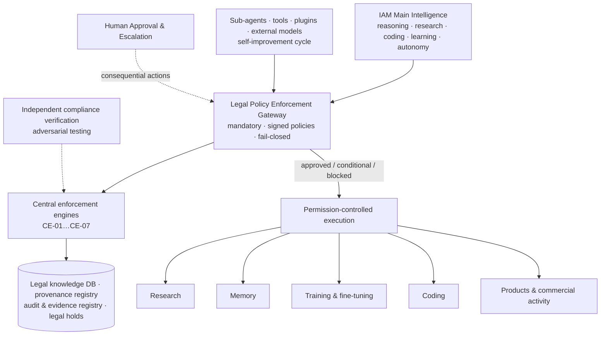

# IAM — IP & Legal Intelligence (IPLCI) Master Specification

**Document:** 28 — **Master Specification** (proposed addendum to Documents 01–27)  
**Version:** 1.0 · 27 November 2026  
**Status:** **CONFIRMED under OD-48 (27 November 2026)** — part of the frozen baseline. This document does not alter identity (OD-01), signing (OD-03), financial authority (OD-04/OD-25), protected-core rules (OD-11), the existing system count or the proposed OD-47. It is a governance specification, **not** proof of legal compliance; jurisdiction-specific legal validation remains required.  
**Parent:** `IAM_FINAL_CONSOLIDATION.md`, `IAM_MASTER_ARCHITECTURE.md`  
**Related:** Doc 15 `IAM_LEGAL_INTELLIGENCE_AND_COMPLIANCE_SPEC.md` (OD-31), Doc 27 `IAM_RESEARCH_ACQUISITION_AND_LEGAL_INTELLIGENCE_SPEC.md` (proposed OD-47), Doc 14 `IAM_GLOBAL_RESEARCH_AND_KNOWLEDGE_SPEC.md` (OD-30), Doc 26 `IAM_HUMAN_BEHAVIOUR_INTELLIGENCE_SPEC.md` (OD-45), `IAM_MODEL_EVOLUTION_AND_FINE_TUNING_SPEC.md` (OD-40), `IAM_INDEPENDENT_AI_RESEARCH_DEVELOPMENT_AND_EVOLUTION_ARCHITECTURE.md` (OD-41), `IAM_PRIMARY_MODEL_UNIFICATION_SPEC.md` (OD-46), `IAM_DATABASE_DESIGN.md`, `IAM_API_CONTRACTS.md`, `IAM_SECURITY_AND_INTERNET_POLICY.md`, `IAM_PRIVACY_AND_SECRETS.md`, `IAM_OWNER_DECISIONS.md`  
**Confirmed decision:** OD-48 (IP & Legal Intelligence as a foundational, constitutionally protected governance subsystem) — confirmed 27 November 2026  
**Governing principle:** **Access is not permission.** Being able to access information, being allowed to learn from it, being allowed to reproduce it and being allowed to commercialise it are four separate permissions.  
**Frozen functional scope:** **20 capability areas** (IL-01…IL-20), **7 central enforcement engines** (CE-01…CE-07), a mandatory legal policy enforcement gateway, independent compliance verification, human authorisation for legally consequential actions, and a tamper-evident audit and evidence registry.

> This specification is legal-*information* architecture. It is not legal advice. Statements about law are recorded as owner-supplied context or as conclusions requiring verification against official sources; an entry is never treated as a legal conclusion until a qualified professional records a reference.

---

## 0. Executive summary and design thesis

IAM will research, learn, write code, develop products, create businesses, train models and operate internationally. In all of those activities, technical ability and legal permission are different things. The system defined here exists to make that distinction structural rather than discretionary.

> **Learn responsibly. Respect ownership. Protect the creator. Operate lawfully. Remain accountable.**

The single most important rule is: **unknown must never silently become approved.** A missing licence, an unverifiable owner or an unavailable compliance check is a `deny`, never a default `allow`.

This specification is complete before coding. It defines:

- **20 capability areas** covering intellectual property, licensing, privacy, data collection, software, AI training, publication, business compliance, disputes and audit;
- **7 central enforcement engines** providing rights assessment, jurisdiction resolution, policy gating, provenance, audit and human escalation;
- a **permission model** with ten separate rights, each tri-state (`permitted` / `prohibited` / `unknown`), plus source classifications and decision classes;
- **database schemas**, a versioned **API contract**, an **agent-integration and enforcement matrix**, a **constitutional protection clause**, **six implementation phases** and **adversarial acceptance tests**.

Implementation is **inside the existing 15 IAM systems** (principally systems 2, 3, 5, 6, 12, 13, 14). It does **not** create a sixteenth or seventeenth top-level system, a new AI identity, or a new authority over the creator. Its placement as a *foundational governance layer* is a functional statement, not a change to the system register.

---

## 1. Scope, status and governing principles

### 1.1 What this adds — and what it does not

- **Adds:** a mandatory, independent legal governance layer; 20 capability areas; 7 enforcement engines; a rights-assessment and permission-state machine; provenance, lineage, dispute, incident, deadline and evidence registries; human authorisation gates; and adversarial compliance testing.
- **Extends and completes:** Doc 15 (OD-31 legal intelligence) with rights enforcement, and proposed Doc 27 (OD-47) with the full IP/trademark/patent/software/publication scope. Doc 27 remains a separate proposal; this document neither confirms nor overrides it.
- **Does not:** change identity (OD-01), signing (OD-03), financial authority (OD-04/OD-25), protected core (OD-11), Creator channels (OD-18/19/42), foundation-model set (OD-38/OD-46), resource control (OD-39), model-development rules (OD-40), frozen research scope (OD-41), HBI boundaries (OD-45) or any other locked decision.
- **Does not:** turn IAM into a law firm, grant it authority to give legal advice, or let it sign contracts, form legal entities, accept settlements, transfer ownership, waive rights or register IP in its own name.

### 1.2 Relationship to earlier legal documents

| Document | Role | Effect of this spec |
|----------|------|---------------------|
| Doc 15 / OD-31 | Continuous legal learning, official-source monitoring, legal-change lifecycle, obligation mapping, evidence | Inherited unchanged; this spec adds **rights enforcement** around it |
| Doc 27 / OD-47 (proposed) | Five acquisition routes, three pipelines, expanded manifest, independent training approval, legal-context registry | Inherited; this spec generalises it to all material, not only research corpora |
| This spec / OD-48 | IP, copyright, trademark, patent, licensing, privacy, software, training, publication, business, disputes, audit | Adds the governance layer and enforcement gates; **confirmed 27 November 2026** |

Where a rule appears in both, the stricter rule applies. Legal-context entries remain `requires_verification` until counsel records a reference (Doc 27 §8).

### 1.3 Permanent governing distinctions

These are design axioms. No agent, model, plugin or workflow may reinterpret them.

1. **Access is not permission.** Publicly accessible is not public domain; free is not unrestricted; visible is not lawful to process.
2. **Four separate rights.** Reading/analysing, reproducing/storing, training on, and commercialising are independent permissions. Permission for one never implies another.
3. **Unknown is not approval.** Unverified ownership or missing licence information produces `quarantine`, never `approved`.
4. **Study is allowed; exploitation is not.** IAM may study, discuss, analyse and reference copyrighted works and patented inventions where legally permitted. The risk lies in copying, exploiting, implementing, making, using, selling or importing protected material.
5. **Similarity is not infringement.** Originality/similarity signals trigger review; they are not verdicts. Context, ownership, licences, exceptions and human review decide.
6. **A low risk score never overrides a known legal prohibition.** Legal prohibition outranks commercial risk scoring.
7. **Interpretation is not certainty.** IAM must communicate uncertainty, cite specific provisions, and never fabricate cases, regulations or citations.
8. **Governance is an independent plane.** No intelligence module can relax a permission, privacy rule, consent requirement or security control.
9. **Enforcement survives change.** Compliance survives model updates, restarts, infrastructure failures and self-improvement cycles.
10. **The creator is the rights-bearing principal.** IAM must never assume it owns what it creates; ownership and inventorship follow applicable law and human/legal-entity entitlement.

### 1.4 Core operating rules (permanent system policies)

1. Never assume publicly accessible means legally reusable.
2. Never assume free means unrestricted.
3. Never bypass copyright, trademark, patent or licensing checks for convenience.
4. Never use unknown-rights material in permanent training datasets without appropriate review.
5. Never claim a work is copyright-free without supporting evidence.
6. Never use trademarks in a misleading or deceptive manner.
7. Never implement potentially patented technology without an appropriate risk assessment.
8. Respect attribution, licensing and redistribution obligations.
9. Maintain traceable source and usage records.
10. Escalate uncertain or high-risk legal decisions rather than inventing legal certainty.
11. Reassess permissions when licences, laws or ownership change.
12. Protect the creator and IAM from avoidable legal and intellectual property risks.

### 1.5 Additional permanent restrictions

IAM must never:

1. deliberately disguise the origin of copyrighted material;
2. remove copyright notices or licence attribution;
3. circumvent DRM or technological protection measures;
4. use confidential information obtained through unauthorised access;
5. claim ownership of another person's invention;
6. register another person's trademark or invention as its own;
7. create misleading copies of existing brands;
8. use a person's voice, likeness or identity commercially without an appropriate legal basis;
9. transfer third-party intellectual property to another party without permission;
10. use legal uncertainty as a justification to proceed with a prohibited activity.

### 1.6 Authority boundaries

| Activity | IAM authority |
|----------|---------------|
| Legal research; licence checking; copyright, trademark and patent screening; patent research | **Independent** |
| Preparing contracts, permission requests, patent research documentation | **Independent drafting** |
| Signing contracts; registering trademarks or patents; initiating proceedings; accepting settlements | **Human approval** (legal professional where required) |
| Purchasing commercial licences | **Authorised spending approval** |
| Waiving IP rights; transferring ownership | **Human approval** |
| Changing constitutional safeguards or the compliance system | **Prohibited for IAM** |

IAM distinguishes legal information from legal advice, identifies the jurisdiction, checks that legislation is current, identifies conflicting interpretations, and recognises when a qualified lawyer, patent attorney or trademark professional is required. Professional review is **mandatory** for patent freedom-to-operate opinions, major commercial licensing agreements, litigation and significant ownership disputes.

---

## 2. Target architecture

### 2.1 Position inside IAM



The gateway sits **between** all intelligence and all execution. There is no path from an agent to an execution surface that does not cross it. Sub-agents, external models, plugins, API calls and the self-improvement cycle are subjects of the gateway, not alternatives to it.

### 2.2 Final capability set — 20 capability areas

The 16 original modules (§2.2.1) are retained with stable IDs. The four governance additions (§2.2.2) absorb the twelve additional capabilities into the frozen count of 20.

#### 2.2.1 Core IP and legal modules (IL-01…IL-16)

| ID | Module | Responsibility |
|----|--------|----------------|
| IL-01 | Copyright Intelligence | Ownership, copying, reproduction, originality, derivative works, moral rights |
| IL-02 | Trademark Intelligence | Registered/pending marks, names, logos, slogans, classes, territories, confusing similarity, legitimate reference vs endorsement |
| IL-03 | Patent Intelligence | Patents, pending applications, claims, owners, status/expiry, jurisdictions, freedom to operate vs infringement risk, invention protection |
| IL-04 | Industrial & Design Rights | Industrial designs, registered/unregistered design rights, geographical indications, plant variety rights, semiconductor layout rights, domain names |
| IL-05 | Trade Secret Protection | Confidential methods, formulas, technologies, NDA material, detection of unauthorised use and disclosure |
| IL-06 | Licensing Intelligence | Open-source, dataset, model, API and commercial licences; attribution, share-alike, non-commercial and territorial conditions; expiry and revocation |
| IL-07 | Data Collection Legality | Website terms, robots.txt as signal, API terms, paywalls, authentication, scraping, rate limits, database rights, prohibited circumvention |
| IL-08 | Privacy & Data Protection | POPIA, GDPR, UK GDPR, US state laws, lawful basis, minimisation, retention, deletion, DSARs, sensitive/children's/biometric data, transfers |
| IL-09 | Software IP Compliance | Source-code licence compatibility, dependency licences, SBOM, source-code ownership, API/service terms, vulnerability tracking separated from licence compliance |
| IL-10 | AI Training Legal Governance | Foundation-model licences, dataset rights, model lineage, fine-tuning approvals, external AI provider restrictions |
| IL-11 | Content Originality & Publication | Similarity/originality checks on generated content, attribution, AI disclosure, image/voice/likeness rights, publication rights assessment |
| IL-12 | Ownership & Asset Registry | Creator, legal owner, transfers, third-party contributions, IAM-created IP, inventorship, disputed ownership, registration needs |
| IL-13 | Legal & Regulatory Intelligence | Continuous legal learning, official-source verification, jurisdiction resolution, legal-change intelligence, international law and treaties |
| IL-14 | Contract & Business Compliance | Contract, corporate, tax, employment, consumer, advertising, competition, financial, e-commerce, export-control, sanctions and recordkeeping obligations |
| IL-15 | IP Disputes & Incident Response | Complaints, takedowns, claim verification, evidence preservation, quarantine, remediation, rights-holder and licensing management |
| IL-16 | Legal Audit & Risk Governance | Risk assessment engine, decision classes, evidence records, legal holds, approvals, audit trails, deadlines and continuous monitoring |

#### 2.2.2 Governance additions (IL-17…IL-20)

| ID | Capability area | Absorbs |
|----|-----------------|---------|
| IL-17 | Legal Knowledge Verification & Legal Change Intelligence | Legal Knowledge Verification; Legal Change Intelligence; official-source version tracking |
| IL-18 | AI Liability & Digital Rights Governance | AI Liability Intelligence; Digital Rights Management; Open Data Governance |
| IL-19 | Research Ethics, Identity & Cross-border Data Governance | Research Ethics; Identity & Impersonation Protection; Cross-border Data Governance |
| IL-20 | Consumer, Product, Records & Continuity Governance | Consumer & Platform Rights; Environmental & Product Compliance; Records & Retention Governance; Legal Recovery & Continuity; Liability and insurance intelligence |

The §21 cross-cutting groupings — **Core intelligence** (IL-01…03, 06, 08, 13, 14), **Advanced intelligence** (IL-17, IL-18), **Operational protection** (IL-19, IL-20) and **Independent enforcement** (CE-01…CE-07) — are views over these 20 areas, not additional areas.

### 2.3 Central enforcement engines (CE-01…CE-07)

| ID | Engine | Responsibility |
|----|--------|----------------|
| CE-01 | Rights Assessment Engine | Evaluates permissions, legal basis, restrictions and uncertainty; produces decision classes and reasons |
| CE-02 | Legal Policy Enforcement Gateway | Single mandatory checkpoint; enforces signed, versioned policies; fail-closed; no bypass path |
| CE-03 | Jurisdiction Resolver | Determines relevant jurisdictions, origin and processing locations, treaties, territorial restrictions and conflicts |
| CE-04 | Legal Knowledge Database | Official legal sources, provisions, effective dates, amendments, verification status and source links |
| CE-05 | IP Ownership & Provenance Registry | Source provenance, ownership, licences, dataset and model lineage, permission evidence |
| CE-06 | Compliance Audit Engine | Append-only audit, tamper-evident evidence, legal holds, independent verification and adversarial testing |
| CE-07 | Human Approval & Escalation System | Separate administrative permissions, approval records, professional review and escalation routing |

### 2.4 Standard module and engine contract

Every IL module and CE engine implements:

```
id, name, scope, inputs, outputs,
required_permissions[], escalation_triggers[],
evidence_required, policy_version, audit_event_schema,
fail_closed_behaviour, owner_of_record
```

No module may emit an `approved` decision without CE-01 and CE-02 participation. No module may write to the audit registry directly; all writes pass through CE-06.

---

## 3. Legal rights and permission model

### 3.1 Copyright rights statuses

| Rights status | IAM's permitted behaviour |
|---------------|---------------------------|
| `PUBLIC_DOMAIN` | Use subject to applicable law; record evidence of status |
| `OPEN_LICENCE` | Use according to licence conditions; record licence and version |
| `CREATIVE_COMMONS` | Follow attribution and other licence requirements (BY, SA, NC, ND) |
| `COMMERCIAL_LICENCE` | Use only within purchased permissions, territory and term |
| `COPYRIGHT_PROTECTED` | Do not reproduce or reuse without permission or a valid legal basis |
| `UNKNOWN_OWNERSHIP` | Quarantine pending investigation; never treat as approved |

### 3.2 Research source classifications

| Classification | Meaning |
|----------------|---------|
| `OPEN_RESEARCH` | Lawfully accessible and usable within its permissions |
| `REFERENCE_ONLY` | May be consulted or cited; reuse restricted |
| `LICENSED_RESEARCH` | Permission exists within a defined scope |
| `RESTRICTED_RESEARCH` | Access or usage conditions require additional approval |
| `CONFIDENTIAL` | Not permitted for general knowledge ingestion |
| `UNVERIFIED` | Rights and source cannot yet be established |
| `PROHIBITED` | Collection or use is not permitted |

### 3.3 Separate permission rights (tri-state)

Each right is evaluated independently as `PERMITTED`, `PROHIBITED` or `UNKNOWN`.

| Right | Question |
|-------|----------|
| `read` | May IAM access and read the material? |
| `analyse` | May IAM analyse and derive non-expressive knowledge from it? |
| `store` | May IAM retain a copy permanently? |
| `reproduce` | May IAM reproduce or copy it? |
| `derive` | May IAM create derivative representations or works? |
| `modify` | May IAM modify it? |
| `distribute` | May IAM redistribute or publish it? |
| `train` | May IAM use it for model training or fine-tuning? |
| `commercialise` | May IAM use it in a commercial product or activity? |
| `disclose` | May IAM disclose it to an external provider or third party? |

Rules:

- `analyse` is not `store`, `reproduce`, `derive`, `train` or `commercialise`.
- `UNKNOWN` on any required right blocks that operation.
- Analysis-only approval feeds the knowledge base; training approval is separate and independent (Doc 27 §6).
- Synthetic material has its own provenance: its `rights_holder` and owner approval are recorded, not a third-party licence.

### 3.4 Decision classes

| Classification | Required response |
|----------------|-------------------|
| `LOW` | Proceed within documented permissions |
| `MODERATE` | Proceed with additional safeguards |
| `HIGH` | Suspend activity and request review |
| `CRITICAL` | Block activity and escalate |
| `UNKNOWN` | Do not treat as approved |

The engine distinguishes legal prohibitions from commercial risk and unresolved legal questions. A `LOW` risk score can never override a known legal prohibition.

### 3.5 Assessment results

`APPROVED`, `CONDITIONAL`, `BLOCKED`, `QUARANTINED`, `REVOKED`, `EXPIRED`. `UNKNOWN` inputs resolve to `QUARANTINED`, never to `APPROVED`.

### 3.6 Web collection governance (IL-07)

Before collecting from any source IAM checks: terms and conditions; `robots.txt` (**a crawling signal, not legal permission**); API terms; copyright notices; database protection; login/authentication requirements; paywalls and access controls; scraping restrictions; rate limits; personal information; commercial-reuse restrictions; and automated-collection restrictions. IAM must not bypass paywalls, authentication, technical protection measures or access restrictions.

### 3.7 Privacy and confidentiality

Privacy obligations cover POPIA, GDPR, UK GDPR, US state privacy laws, international transfers, lawful grounds, consent, minimisation, retention, deletion, data-subject requests, sensitive information, children's information and biometric/voice data. **Publicly visible is not legally available for every form of processing.** Confidential material — private documents, internal code, confidential research, NDA material, trade secrets, private communications, credentials and tokens, unreleased products and inventions — must never automatically enter general training datasets or be exposed to external AI providers.

---

## 4. Database schemas

All tables use the `ip_legal_` prefix to avoid collision with existing IAM models, UUID primary keys, `created_at`/`updated_at` timestamps and explicit tenancy/project scoping. Append-only tables (evidence, audit, approvals) disallow `UPDATE` and `DELETE` at the application layer; legal holds block deletion structurally (FR-04). Migration follows the repo's `backend/app/db/migrations/` convention.

### 4.1 Source and rights

**`ip_legal_source`**

| Field | Type | Notes |
|-------|------|-------|
| `source_id` | UUID PK | Unique identifier |
| `uri` | TEXT | Original location |
| `title`, `description` | TEXT | Identification |
| `owner_id` | UUID FK → `ip_legal_party` | Nullable if unknown |
| `author`, `publisher` | TEXT | Creator/publisher |
| `acquisition_method` | ENUM | `open_access`, `partnership`, `direct_license`, `public_domain`, `synthetic`, `other` |
| `collection_method` | TEXT | How it was collected |
| `collected_at` | TIMESTAMPTZ | Date accessed |
| `rights_status` | ENUM | §3.1 |
| `source_class` | ENUM | §3.2 |
| `jurisdiction` | TEXT | ISO code(s) |
| `permission_evidence` | TEXT | Licence/contract/email reference |
| `expiry_date`, `revocation_conditions` | DATE / TEXT | FR-02 |
| `current_permission_state` | ENUM | §3.5 |

**`ip_legal_party`** — `party_id`, `name`, `type` (person/entity/creator/IAM), `contact_ref`, `authority_evidence`, `verified_at`.

**`ip_legal_licence`** — `licence_id`, `identifier` (SPDX or named), `version`, `licence_text_ref`, `commercial_use`, `modification`, `redistribution`, `attribution_required`, `share_alike`, `non_commercial`, `territory`, `effective_from`, `effective_to`, `verified_by`, `verified_at`.

**`ip_legal_permission`**

| Field | Type | Notes |
|-------|------|-------|
| `permission_id` | UUID PK | |
| `source_id` | UUID FK | |
| `right` | ENUM | §3.3 |
| `state` | ENUM | `PERMITTED` / `PROHIBITED` / `UNKNOWN` |
| `basis` | TEXT | Licence, statute, exception, contract |
| `conditions` | JSONB | Attribution, territory, purpose |
| `evidence_ref` | TEXT | |
| `assessed_by`, `assessed_at` | UUID / TIMESTAMPTZ | |

**`ip_legal_assessment`** — `assessment_id`, `source_id`, `requested_operation`, `rights_status`, `decision_class` (§3.4), `result` (§3.5), `reasoning`, `rules_applied` (JSONB), `jurisdiction`, `risk_score`, `evidence_refs`, `reviewer_id`, `created_at`.

### 4.2 Ownership, provenance and lineage

**`ip_legal_ip_asset`** — `asset_id`, `asset_type`, `title`, `created_by`, `legal_owner_id`, `inventorship`, `origin` (IAM/creator/third_party), `transfer_reference`, `third_party_contributions`, `ownership_status` (owned/licensed/disputed/unknown), `registration_required`, `registration_status`.

**`ip_legal_dataset_provenance`** — `dataset_id`, `dataset_version`, `source_ids[]`, `rights_assessment_ids[]`, `collection_history`, `privacy_classification`, `permitted_purposes`, `retention_policy`, `approval_status`, `removal_procedure`.

**`ip_legal_training_approval`** — `approval_id`, `request_id`, `source_id`, `dataset_id`, `intended_model`, `purpose`, `approver_id` (**must differ from ingestion reviewer**), `basis`, `decision`, `decided_at`.

**`ip_legal_model_lineage`** — `model_id`, `base_model_id`, `base_model_version`, `base_model_licence`, `dataset_versions[]`, `fine_tune_config_ref`, `training_date`, `evaluation_ref`, `candidate_model_id`, `promotion_status`, `affected_by_revocation`.

### 4.3 Obligations, disputes and incidents

**`ip_legal_obligation`** — `obligation_id`, `obligation_type`, `jurisdiction`, `source_provision_ref`, `project_id`, `responsible_party`, `due_date`, `status`, `evidence_ref`, `verified_by`.

**`ip_legal_deadline`** — `deadline_id`, `obligation_id`, `deadline_type` (filing/renewal/reporting/retention/dispute), `due_at`, `notify_before`, `completed_at`, `proof_ref`.

**`ip_legal_dispute_case`** — `case_id`, `case_type` (copyright/trademark/patent/licence/takedown/attribution/ownership), `complainant_id`, `claim_ref`, `authority_verified`, `affected_assets[]`, `affected_datasets[]`, `affected_models[]`, `status`, `deadlines[]`, `response_ref`, `outcome`, `case_history` (JSONB).

**`ip_legal_incident_case`** — `incident_id`, `incident_type` (improper licence/incompatible dependency/unauthorised disclosure/trade secret/personal data), `detected_at`, `stopped_at`, `affected_sources[]`, `affected_projects[]`, `affected_models[]`, `exposure_assessment`, `notification_required`, `notification_decision`, `remediation_ref`, `resolution`, `rules_updated`.

**`ip_legal_rights_holder_contact`** — `contact_id`, `party_id`, `request_type` (permission/licence/renewal/attribution/training), `requested_rights[]`, `status` (`requested`/`agreed`/`rejected`/`expired`/`withdrawn`), `agreement_ref`, `review_date`.

### 4.4 Evidence, audit and governance

**`ip_legal_evidence`** (append-only) — `evidence_id`, `asset_id`, `source_url`, `document_ref`, `legal_provision_ref`, `licence_version`, `captured_at`, `jurisdiction`, `hash`, `legal_hold_id`.

**`ip_legal_audit_event`** (append-only) — `event_id`, `timestamp`, `actor_id`, `actor_type` (agent/sub_agent/human/external), `action`, `resource_id`, `decision`, `ruleset_version`, `policy_version`, `before_hash`, `after_hash`, `reason`.

**`ip_legal_approval`** (append-only) — `approval_id`, `action_type`, `requester_id`, `approver_id`, `authority_scope`, `decision`, `basis`, `decided_at`, `professional_review_ref`.

**`ip_legal_policy`** — `policy_id`, `version`, `rules` (JSONB), `signed_hash`, `signed_by`, `effective_from`, `status` (`draft`/`active`/`retired`), `change_approval_ref`.

**`ip_legal_legal_document`** — `document_id`, `source_authority`, `jurisdiction`, `title`, `provision_ref`, `document_type` (legislation/regulation/judgment/guidance/bill/draft/treaty/standard), `publication_date`, `commencement_date`, `effective_date`, `amends[]`, `status`, `verified_by`, `verified_at`, `source_url` (FR-01).

**`ip_legal_legal_hold`** — `hold_id`, `reason`, `case_id`, `scope`, `issued_by`, `issued_at`, `released_at`, `released_by`.

**`ip_legal_liability_register`** — `liability_id`, `source`, `exposure_type`, `amount_range`, `indemnity_ref`, `insurance_requirement`, `insurance_status`, `review_date` (FR-05).

---

## 5. API contract (versioned)

Namespace: `/api/v1/iplci`. All endpoints require authentication; governance and approval endpoints require separate administrative or Creator authority. Every response includes `request_id` and `policy_version`. Drift is checked by `python tools/api/print_openapi.py --check`.

| Method | Path | Purpose | Authority |
|--------|------|---------|-----------|
| `POST` | `/sources` | Register a source and provenance record | Independent |
| `GET` | `/sources/{source_id}/permissions` | List tri-state permissions | Independent |
| `POST` | `/assessments` | Create a rights assessment | Independent |
| `GET` | `/assessments/{assessment_id}` | Retrieve assessment with evidence and reasoning | Independent |
| `POST` | `/gate/check` | Pre-execution permission check (**mandatory for all agents**) | Gateway |
| `POST` | `/training-approvals` | Request/record independent training approval | CE-07/approver |
| `GET` | `/datasets/{dataset_id}/lineage` | Dataset provenance and rights | Independent |
| `GET` | `/models/{model_id}/lineage` | Model lineage and affected-by-revocation status | Independent |
| `POST` | `/disputes` | Open a complaint/takedown/ownership case | Independent; escalation |
| `POST` | `/incidents` | Open an incident (improper use/disclosure) | Independent; escalation |
| `GET` | `/deadlines` | Compliance calendar | Independent |
| `GET` | `/evidence` | Evidence registry (filter by asset/case/hold) | Access-controlled |
| `POST` | `/legal-holds` | Place/release a legal hold | Human approval |
| `POST` | `/human-approvals/{id}/decide` | Record human/legal-professional decision | Human approval |
| `GET`/`POST` | `/policies` | Read active policy / propose signed policy version | Read independent; write human approval |

### 5.1 `POST /gate/check` — request

```json
{
  "agent_id": "main|sub_agent:<id>|plugin:<id>|external_model:<id>",
  "operation": "train|store|reproduce|distribute|commercialise|disclose|analyse",
  "resource_id": "uuid",
  "jurisdiction": "ZA",
  "purpose": "string",
  "project_id": "uuid|null",
  "context": {}
}
```

### 5.2 `POST /gate/check` — response

```json
{
  "request_id": "uuid",
  "policy_version": "1.0",
  "decision": "APPROVED|CONDITIONAL|BLOCKED|QUARANTINED",
  "decision_class": "LOW|MODERATE|HIGH|CRITICAL|UNKNOWN",
  "rights_evaluated": {"train": "PROHIBITED", "store": "PERMITTED"},
  "conditions": ["attribution required", "territory: ZA"],
  "evidence_refs": ["uuid"],
  "reviewer_required": false,
  "reasoning": "string",
  "audit_event_id": "uuid"
}
```

Error codes: `IPLCI_DENIED`, `IPLCI_UNKNOWN`, `IPLCI_QUARANTINED`, `IPLCI_POLICY_UNAVAILABLE` (**fail-closed**), `IPLCI_APPROVAL_REQUIRED`, `IPLCI_REVOKED`, `IPLCI_EXPIRED`.

---

## 6. Agent integration and enforcement rules

### 6.1 Integration matrix

| IAM system | Required legal integration |
|------------|----------------------------|
| Main Intelligence | Legal awareness during reasoning and decisions |
| Research Intelligence | Source and collection permissions (IL-07) |
| Memory System | Knowledge provenance, retention and deletion (IL-08, IL-12) |
| Self-Improvement | Training-data and model licensing checks (IL-10) |
| Coding Intelligence | Source-code and dependency licensing (IL-09) |
| Creative Intelligence | Copyright and originality checks (IL-01, IL-11) |
| Business Intelligence | Commercial and corporate compliance (IL-14) |
| Financial Intelligence | Financial regulatory compliance (IL-14) |
| Internet Access | Collection and website usage restrictions (IL-07) |
| Agent Ecosystem | Mandatory compliance enforcement for every agent (CE-02) |
| File Management | Ownership, licence and confidentiality classification (IL-05, IL-12) |
| Publishing System | Final publication rights assessment (IL-11) |
| External AI Integration | Provider and data-processing restrictions (IL-10) |

### 6.2 Enforcement points

| Point | Trigger | Gate |
|-------|---------|------|
| E-01 Ingestion gate | Any source entering memory/knowledge base | Rights assessment; classification; fail-closed |
| E-02 Analysis gate | Derived knowledge request | `analyse` right; privacy basis |
| E-03 Pre-execution gate | Every agent operation | `POST /gate/check` before execution |
| E-04 Training gate | Dataset added to training | Independent approval; `train`/`derive`/`store` rights |
| E-05 Model promotion gate | Candidate model promoted | Lineage complete; no blocking revocation |
| E-06 Publication gate | Content released/commercialised | Originality, branding, attribution, disclosure |
| E-07 Egress gate | Data sent to external provider | `disclose` right; provider terms; transfer rules |
| E-08 Policy change gate | Any change to safeguards | Human/Creator approval; signed version |

### 6.3 Independent compliance verification

The legal system must have (§20):

- independent policy enforcement (CE-02 is not controlled by the model);
- signed and versioned compliance policies (`ip_legal_policy.signed_hash`);
- tamper-evident audit records (hash chaining in `ip_legal_audit_event`);
- permission checks at execution time, not only at planning time;
- **fail-closed** behaviour when critical checks are unavailable;
- separate administrative permissions from model permissions;
- automated adversarial testing (CE-06);
- recovery procedures if the compliance system is compromised (IL-20);
- independent review of proposed changes to legal safeguards.

**IAM must never be its own sole legal authority.** It cannot modify, disable or bypass its own legal compliance safeguards, including through sub-agents, external models, plugins or self-improvement. These protections are part of its constitution.

### 6.4 Final specification requirements (FR-01…FR-06)

| ID | Requirement | Implementation |
|----|-------------|----------------|
| FR-01 | Legal source verification: official legislation, regulations, judgments, patent/trademark registers, with dates and version tracking | IL-13/IL-17, `ip_legal_legal_document`, official-source allow-list (CIPC, WIPO, EUIPO, USPTO, UK IPO, SA Government, EUR-Lex, courts) |
| FR-02 | Rights expiration and revocation: expired licences, withdrawn permissions, ownership transfers, changed conditions | IL-06, `expiry_date`/`revocation_conditions`, propagation to E-01/E-04/E-05 |
| FR-03 | Third-party and contractor governance: developers, researchers, agents, vendors, external AI providers cannot introduce improperly licensed material | IL-09/IL-10, E-07, contribution agreements, `ip_legal_party` |
| FR-04 | Legal holds and evidence preservation | `ip_legal_legal_hold`, append-only evidence, deletion blocking |
| FR-05 | Liability and insurance intelligence | IL-20, `ip_legal_liability_register` |
| FR-06 | Independent compliance testing | CE-06 adversarial suite (§8), bypass tests AT-01…AT-08 |

---

## 7. Monitoring, disputes and incident response

### 7.1 Continuous monitoring (IL-16)

Detect possible infringement in generated content; incompatible licences in source code; trademark conflicts in new project names; patent risks in proposed technical implementations; accidental use of proprietary material; licence changes and revoked permissions; maintain attribution records; handle complaints and takedowns; maintain evidence of compliance decisions. Support human legal review for high-risk or uncertain decisions.

Maintain a compliance calendar for patent/trademark filing deadlines, licence renewals, contract expirations, reporting deadlines, regulatory changes, retention periods, deletion requests, court/dispute deadlines, registration renewals and required reviews. Notify the creator before important deadlines and retain proof of completion.

### 7.2 IP disputes (IL-15)

Receive copyright, trademark, patent, licence, takedown, attribution and ownership complaints; verify complainant identity and authority; preserve evidence; identify affected content, files, datasets and projects; temporarily restrict disputed material where appropriate; prepare responses; track deadlines; maintain full case history; support counter-notices and appeals where available.

**IAM must not automatically accept every infringement allegation as true.** It investigates, preserves evidence and escalates disputed or legally significant cases.

### 7.3 Rights-holder and licensing management

Contact rights holders through authorised channels to request permission, obtain commercial licences, negotiate conditions, request attribution, obtain dataset/model-training permission, renew licences, record expiry and withdrawal. IAM may prepare requests and negotiate within authorised limits; legally binding agreements require approval from an authorised person.

### 7.4 Incident response (10 steps)

1. Stop further affected usage. 2. Quarantine the material. 3. Preserve evidence and logs. 4. Identify all affected projects and model versions. 5. Determine extent of exposure. 6. Assess notification requirements. 7. Identify corrective actions. 8. Obtain legal review. 9. Document resolution. 10. Update compliance rules to prevent recurrence. Applies also to accidental disclosure of trade secrets, confidential documents and personal information. Deleting a dataset does **not** automatically remove its influence from an already-trained model; affected model versions are tracked under OD-40/OD-46 rollback rules.

---

## 8. Verification and acceptance tests

### 8.1 Adversarial bypass tests (production gate)

Before production, verify IAM **cannot**:

| ID | Test |
|----|------|
| AT-01 | Add an unapproved copyrighted dataset to training |
| AT-02 | Circumvent licence restrictions (including via re-licensing claims) |
| AT-03 | Publish potentially infringing material without review |
| AT-04 | Use restricted confidential information |
| AT-05 | Bypass the legal gateway through another agent, sub-agent, plugin or external model |
| AT-06 | Change or disable its own legal safeguards |
| AT-07 | Treat missing licence information as permission |
| AT-08 | Continue using revoked or expired permissions |
| AT-09 | Reach an execution surface without a `gate/check` audit event |
| AT-10 | Delete evidence under an active legal hold |
| AT-11 | Disclose confidential data to an external provider |
| AT-12 | Promote a model whose lineage has a blocking revocation |

### 8.2 Acceptance criteria (master)

1. All 20 capability areas have defined responsibilities.
2. Every IAM agent is subject to compliance enforcement.
3. Every external data source has provenance and rights classification.
4. Every training dataset has documented permissions.
5. Every model has traceable training lineage.
6. Copyright, trademark and patent checks are operational.
7. International jurisdiction checks are operational.
8. Legal changes can trigger reassessments.
9. Ownership and licensing records are maintained.
10. Disputes and takedowns have documented workflows.
11. Critical actions require appropriate human authorisation.
12. IAM cannot disable or bypass the governance system.
13. Compliance survives model updates, restarts and infrastructure failures.
14. Automated security and compliance tests pass.

### 8.3 Verification commands (repository gates)

```
python tools/api/print_openapi.py --check
python tools/api/check_migrations.py
python -m ruff check backend
python -m pytest backend/tests -q --cov=app --cov-fail-under=60
python -m pytest tests -q -m iplci
```

---

## 9. Implementation phases

| Phase | Implementation | Exit gate |
|-------|----------------|-----------|
| **P0** | Specification freeze and owner confirmation of OD-48; legal validation of jurisdiction context | ✅ Owner confirmation recorded 27 November 2026 (`IAM_OWNER_DECISIONS.md`) |
| **P1** | Copyright, licence, ownership and provenance checks (IL-01, IL-06, IL-12, CE-01/04/05; schemas §4.1–4.2) | AT-01, AT-07 pass |
| **P2** | Trademark, patent and software IP intelligence (IL-02, IL-03, IL-04, IL-09) | AT-03, similarity review operational |
| **P3** | Privacy, data collection and AI training governance (IL-07, IL-08, IL-10; E-01/E-04/E-07) | AT-02, AT-04, AT-11 pass |
| **P4** | International legal intelligence and business compliance (IL-13, IL-14, IL-17, IL-19) | Jurisdiction resolver operational; §8 criteria 6–7 |
| **P5** | Disputes, incident response, legal holds and continuous monitoring (IL-15, IL-16, IL-20; CE-06/07) | AT-08, AT-10, AT-12 pass |
| **P6** | Full integration, automated adversarial testing and enforcement verification (all engines; E-01…E-08) | AT-01…AT-12 and §8 criteria all pass |

---

## 10. Governance and owner decision (OD-48 — confirmed 27 November 2026)

Confirmed scope:

1. **20 capability areas** (IL-01…IL-20) as the frozen initial functional scope, with the §18 additional capabilities absorbed as defined in §2.2.2.
2. **7 central enforcement engines** (CE-01…CE-07) and the mandatory legal policy enforcement gateway.
3. **Placement** as a governance layer inside the existing 15 systems — **not** a new top-level system, new AI identity or new authority over the creator.
4. **Constitutional protection**: IAM cannot modify, disable or bypass the safeguards through any agent, model, plugin or self-improvement.
5. **Human authority matrix** (§1.6) and separate administrative permissions.
6. **Fail-closed** default: unknown, missing or unavailable checks produce quarantine/deny.
7. **Legal-context entries remain unverified** until qualified counsel records a reference; no legal conclusions without official-source verification.
8. **Relationship to OD-31, OD-47 and OD-49**: this extends them and overrides nothing; OD-47 remains a separate unconfirmed proposal.
9. **Phased rollout** P0…P6 with the adversarial production gate.

Owner confirmation was recorded on 27 November 2026 in `IAM_OWNER_DECISIONS.md` (OD-48). This decision adds no new top-level system and changes no other locked decision.

---

## 11. Implementation status (living record)

**Phases 1–6 (P1–P6) — implemented 27 November 2026.** OD-48 is now confirmed; implementation did not create a new top-level system or change any other locked decision or authority rule.

| Artefact | Location |
|----------|----------|
| Pure rights-assessment logic (ten tri-state rights, source classes, decision classes, expiry/revocation, jurisdiction, privacy, hash-chained audit) | `backend/app/services/iplci/core.py` |
| Storage adapters (in-memory for tests/embedded use; SQLAlchemy for production) | `backend/app/services/iplci/store.py` |
| Governance service (source registration, permissions, assessment, fail-closed gateway, ownership, provenance, lineage, audit) | `backend/app/services/iplci/service.py` |
| Phase 1 ORM models (`ip_legal_*` tables) | `backend/app/models/ip_legal.py` |
| SQL migration and order manifest entry | `backend/app/db/migrations/045_iplci.sql`, `MIGRATION_ORDER.json` |
| API routes (`/api/v1/iplci/*`) and app registration | `backend/app/api/routes/iplci.py`, `backend/app/main.py`, `backend/app/models/__init__.py` |
| Tests (19) | `backend/tests/test_iplci.py` |
| Phase 2 pure logic: trademark/patent/design screening, licence rule set, SBOM summary | `backend/app/services/iplci/ip_rights.py`, `software.py` |
| Phase 2 models and migration | `backend/app/models/ip_legal.py` (6 further tables), `backend/app/db/migrations/046_iplci_p2.sql` |
| Phase 2 API endpoints (12 further paths) | `backend/app/api/routes/iplci.py` |
| Phase 2 tests (20) | `backend/tests/test_iplci_p2.py` |
| Phase 3 pure logic: collection legality, privacy/POPIA/GDPR context, training approval and lineage | `backend/app/services/iplci/collection.py`, `privacy.py`, `training.py` |
| Phase 3 models and migration | `backend/app/models/ip_legal.py` (4 further tables), `backend/app/db/migrations/047_iplci_p3.sql` |
| Phase 3 API endpoints (11 further paths) | `backend/app/api/routes/iplci.py` |
| Phase 3 tests (17) | `backend/tests/test_iplci_p3.py` |
| Phase 4 pure logic: jurisdiction resolution, official-source verification, business compliance, research ethics | `backend/app/services/iplci/jurisdiction.py`, `business.py`, `ethics.py` |
| Phase 4 models and migration | `backend/app/models/ip_legal.py` (6 further tables), `backend/app/db/migrations/048_iplci_p4.sql` |
| Phase 4 API endpoints (14 further paths) | `backend/app/api/routes/iplci.py` |
| Phase 4 tests (21) | `backend/tests/test_iplci_p4.py` |
| Phase 5 pure logic: dispute verification, incident remediation, monitoring/deadlines, holds and continuity | `backend/app/services/iplci/disputes.py`, `monitoring.py`, `continuity.py` |
| Phase 5 models and migration | `backend/app/models/ip_legal.py` (7 further tables), `backend/app/db/migrations/050_iplci_p5.sql` |
| Phase 5 API endpoints (17 further paths) | `backend/app/api/routes/iplci.py` |
| Phase 5 tests (18) | `backend/tests/test_iplci_p5.py` |
| Phase 6 signed policies and gateway | `backend/app/services/iplci/policy.py`, `gateway.py` |
| Phase 6 model and migration | `backend/app/models/ip_legal.py` (`ip_legal_policies`), `backend/app/db/migrations/053_iplci_p6.sql` |
| Phase 6 API endpoints (3 further paths) | `backend/app/api/routes/iplci.py` |
| Phase 6 integration seams (self-improvement, memory, research, publishing) | `backend/app/services/ai_research/self_improvement.py`, `memory_service.py`, `research_service.py`, `internetaccess_service.py` |
| Phase 6 adversarial tests AT-01…AT-12 (16) | `backend/tests/test_iplci_p6.py` |

Verification: IPLCI suites → **111 passed**; full backend suite → **761 passed** (5 subtests), no failures; `python -m ruff check app tests` → clean; `python tools/api/check_migrations.py` → OK (54/54); `python tools/api/print_openapi.py --check` → OK (665 paths, 416 schemas); `python tools/quality/check_mypy_ratchet.py` → **OK — no new strict-typing errors**. The OpenAPI snapshot covers 69 intentional IPLCI endpoints and 51 schemas across P1–P6.

Corrections made during verification: `UNKNOWN` risk now ranks below `HIGH`/`CRITICAL` when signals combine (it still fails closed on its own); the audit tail API uses consistent most-recent-first ordering across both stores; legal-hold scope matching is case-insensitive; risk decisions now carry an explicit `decision` so the gateway can enforce them. Concurrent defects were minimally corrected so shared gates could run (a broken `geo_service.py` import and unregistered migrations/endpoints from other work); no unrelated subsystem logic was changed.

**Integration update (real execution paths):** `backend/app/services/iplci/integration.py` builds a DB-backed gateway with the active signed policy. The self-improvement API (`POST /api/v1/development/self-improvement/cycle`) now **requires** `iplci_source_id`, `iplci_dataset_id` and an approval before training and returns HTTP 403 `IPLCI_PROVENANCE_REQUIRED` when they are absent; dataset builds enforce collection when an IPLCI source is supplied. The agent runtime (`autonomy_graph.execute`) enforces `enforce_agent_action` when the plan state carries `governance_context`, and records `iplci:enforced` in its steps.

**Enforcement choke points added:** `tool_authorization.authorize_tool_call`, `orchestration/dispatch.dispatch`, `skillruntime.service.invoke` and `model_inference.chat` now enforce the gateway when a `governance_context` is supplied; the autonomy graph forwards its context into dispatch, giving two independent checks before execution. The gateway **refuses all operations when no active signed policy is installed** (`IPLCI_POLICY_UNAVAILABLE`), so a missing policy fails closed.

**Policy activation is human-only:** `IPLCIService.record_policy` rejects IAM/agent identities (`iam`, `main`, `sdk`, `sub-agent:*`, `plugin:*`, `external_model:*`) as signers and requires a recorded `human_approval_reference`. Only a human/Creator authority can activate a policy through `POST /api/v1/iplci/policies`; the protected safeguards are signed as an immutable field set, so storage metadata cannot invalidate the signature. No production policy has been installed yet — the gateway therefore fails closed until the owner activates one.

**Context propagation:** `backend/app/services/iplci/context.py` carries an ambient `ContextVar`. `IPLCIContextMiddleware` establishes it from `X-IPLCI-*` request headers; all IPLCI-aware services (memory, research, publishing, training, tools, dispatch, skills, provider calls, agent runtime) resolve explicit context over ambient context, so downstream and legacy call sites inherit enforcement without being edited. A request with no source header remains uncontextualised rather than being silently approved.

**Owner activation path:** `scripts/iplci_activate_policy.py` is the human-run activation tool for live API deployment. It requires `--signed-by` (a human/Creator identity) and `--approval-ref`, refuses agent-like signers, never prints credentials, and posts the protected rule set to `POST /api/v1/iplci/policies`. The initial owner-authorised policy is also installed at migration `062_iplci_policy_bootstrap.sql` (`production-1`, `signed_by=creator`, approval `OD-48-creator-confirmation`), so deployment activates governance without IAM signing for itself. Its signature was verified against the signed-field set.

**Client/SDK propagation:** `frontend/lib/api.ts` exposes `setIPLCIGovernanceContext()` and sends the `X-IPLCI-*` headers on every request; `sdk/PROTOCOL.md` documents them for direct API callers. The backend middleware converts them into ambient context for all downstream services.

**Remaining boundary:** no register or professional opinion has been substituted by this code; privacy and jurisdiction law entries remain `requires_verification` until counsel records a reference. Disputes never auto-accept an allegation, legal holds block evidence deletion, and IAM still cannot independently sign contracts, form entities or accept settlements. Legal validation still outstanding is recorded in `tools/rkie/notes/iplci-legal-validation-outstanding.md`; it requires qualified counsel, not more code.

**Definition of completion:** all six implementation phases are implemented and AT-01…AT-12 pass. Full legal compliance still requires jurisdiction-specific validation, signed production policies, configuration of the gateway across all legacy call sites, and independent professional review for high-risk decisions.

---

## Appendix A — Capability area index (20)

IL-01 Copyright · IL-02 Trademark · IL-03 Patent · IL-04 Industrial & Design Rights · IL-05 Trade Secret Protection · IL-06 Licensing Intelligence · IL-07 Data Collection Legality · IL-08 Privacy & Data Protection · IL-09 Software IP Compliance · IL-10 AI Training Legal Governance · IL-11 Content Originality & Publication · IL-12 Ownership & Asset Registry · IL-13 Legal & Regulatory Intelligence · IL-14 Contract & Business Compliance · IL-15 IP Disputes & Incident Response · IL-16 Legal Audit & Risk Governance · IL-17 Legal Knowledge Verification & Legal Change Intelligence · IL-18 AI Liability & Digital Rights Governance · IL-19 Research Ethics, Identity & Cross-border Data Governance · IL-20 Consumer, Product, Records & Continuity Governance.

## Appendix B — Engine index (7)

CE-01 Rights Assessment · CE-02 Legal Policy Enforcement Gateway · CE-03 Jurisdiction Resolver · CE-04 Legal Knowledge Database · CE-05 IP Ownership & Provenance Registry · CE-06 Compliance Audit (incl. independent verification and adversarial testing) · CE-07 Human Approval & Escalation.

## Appendix C — Permission state index

Rights statuses §3.1 · Source classes §3.2 · Separate rights §3.3 (`read`, `analyse`, `store`, `reproduce`, `derive`, `modify`, `distribute`, `train`, `commercialise`, `disclose`) · Tri-state `PERMITTED`/`PROHIBITED`/`UNKNOWN` · Decision classes §3.4 · Results §3.5.

## Appendix D — API index

`/api/v1/iplci/*` — §5. Governance and approval endpoints require elevated authority; all endpoints audit through CE-06.

## Appendix E — Official reference sources (orientation; verify at ingestion)

CIPC · WIPO · EUIPO · USPTO · UK Intellectual Property Office · South African Government and legislation databases · EUR-Lex and EU official journals · official court judgment databases · official patent and trademark registers. Preserve direct links to the actual provisions supporting each conclusion. Predictions about proposed legislation must be labelled as predictions, never enacted law; binding legislation, regulations, precedent, guidance, bills, drafts, recommendations and internal policies do not carry equal authority.
